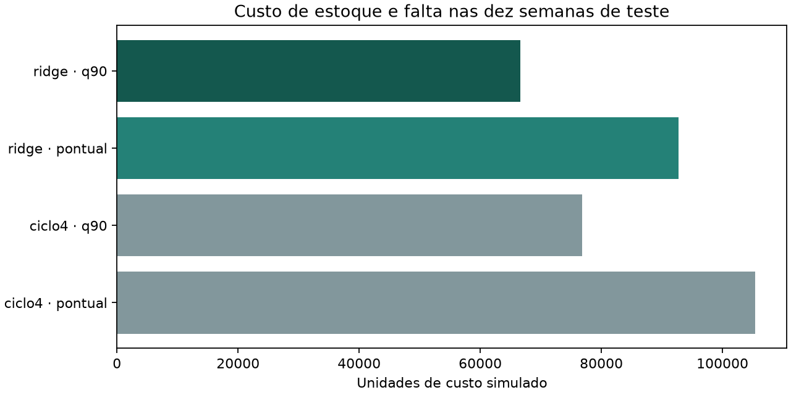

# Quanto comprar na próxima semana?

Previsão semanal e reposição periódica para 811 produtos. O resultado é um pedido inteiro por produto e unidade operacional. A demonstração roda offline após instalar as dependências.



## 1. Negócio
O comprador revisa a posição uma vez por semana. O objetivo é minimizar o custo simulado de manter saldo e perder vendas. Comparamos políticas sob os mesmos prazos, saldos iniciais e trajetórias de consumo. CRISP-DM organiza o trabalho porque a métrica de previsão precisa ser traduzida em uma decisão de compra que a operação consiga executar.

## 2. Dados
James Tan, Sales Transactions Weekly, UCI Machine Learning Repository. Dados sob [CC BY 4.0](https://creativecommons.org/licenses/by/4.0/). Transformação incluída: dos 811 registros com W0 a W51 para 42.172 linhas produto–semana. Descartamos os campos normalizados do arquivo original. [Fonte e atribuição](https://archive.ics.uci.edu/dataset/396/sales+transactions+dataset+weekly).

A base informa vendas por produto. O valor “carteira” no campo loja representa a agregação original. Com histórico próprio, o programa aceita múltiplas lojas com a mesma grade de semanas. Estoque, prazos, custo de falta, pedidos passados e promoções não estão disponíveis na fonte. Vendas podem subestimar a demanda quando há ruptura. Aqui servem como trajetória exógena de consumo para comparar políticas. O horizonte de um ano impede validar sazonalidade anual.

## 3. Preparação e desenho temporal
Validação exige chaves únicas, semanas consecutivas desde zero, vendas completas, inteiras e não negativas. As origens móveis usam pelo menos oito semanas passadas. O alvo soma as próximas L+1 semanas, cobrindo o prazo de entrega L mais o período de revisão. Na origem t, só entram no treino alvos já concluídos antes de t. Para testar vazamento, alteramos o futuro e verificamos que a previsão permanece igual.

Calibração com origens desde a semana 25 e janelas encerradas até a semana 35. Seleção da política pelo custo nas semanas 36–41 com prazo de uma semana. Avaliação final nas semanas 42–51. As famílias de política e o ajuste de segurança ficam fixos; o modelo da média reaprende a cada origem com o histórico então disponível. Cada simulação começa com saldo igual à média das quatro semanas anteriores vezes L+1, arredondada para cima, e trânsito zero.

## 4. Modelagem
O baseline repete as vendas de quatro semanas antes. Esse ciclo é uma hipótese simples de comparação. A regressão Ridge global aprende com todos os itens, usando vendas recentes, médias, variação e tendência. A regularização é fixa. Para cada método comparamos o alvo pontual com um limite superior empírico de 90%. Calculamos o percentil 90 dos resíduos históricos divididos por raiz(1 + previsão) e reescalamos pela demanda prevista na origem atual. Essa aproximação compartilha informação entre itens e precisa de verificação por faixa de volume.

## 5. Avaliação e decisão
A cada semana chegam pedidos vencidos; o comprador subtrai saldo disponível e trânsito do alvo e pede o faltante, arredondando o alvo para cima. Depois ocorre o consumo. Demanda não atendida vira venda perdida. O saldo passa à próxima semana. Não há atrasos aleatórios, capacidade, lote mínimo ou transferência entre lojas.

Custo = soma do saldo final semanal × 1 + unidades perdidas × 8. São unidades de custo hipotéticas. Incluímos cenários com penalidade 4 e 16 e prazo de duas semanas. Os pedidos em trânsito no fim não têm penalidade terminal. A janela curta e os estados de partida influenciam a comparação. Os modelos recebem a história de vendas da fonte mesmo quando o simulador gera perdas. Operar em malha fechada exige registrar indisponibilidade e estimar demanda censurada.

| Modelo e alvo | WAPE | Unidades atendidas | Saldo médio por item | Custo |
|---|---:|---:|---:|---:|
| Ciclo de 4 semanas, pontual | 24,44% | 85,43% | 2,92 | 105.371 |
| Ciclo de 4 semanas, Q90 | 24,44% | 96,60% | 7,12 | 76.781 |
| Ridge, pontual | 20,37% | 87,36% | 2,71 | 92.794 |
| Ridge, Q90 | 20,37% | 95,24% | 4,93 | 66.646 |

A política escolhida na validação foi Ridge Q90. No teste, ela custou 13,20% menos que o ciclo com a mesma regra de segurança, com atendimento 1,36 ponto percentual menor. A cobertura empírica foi 81,04% para o alvo nominal de 90%. Cobertura conta quantas observações ficaram abaixo do limite; atendimento conta unidades efetivamente entregues. WAPE divide erro absoluto total pela soma dos consumos no horizonte. Para métricas de previsão descartamos janelas que terminam fora do período avaliado. O custo usa todas as semanas.

Com prazo de duas semanas, a Ridge pontual teve menor WAPE que o ciclo pontual (17,73% contra 20,06%), mas custo ligeiramente maior (110.321 contra 110.189). A escolha do algoritmo requer testar o efeito sobre o estoque. Recomendação: piloto restrito após medir prazos e custos reais e verificar cobertura por produto.

## 6. Operação e reprodução
Abra a pasta no VS Code e use PowerShell. A pasta resultados já contém a execução de referência.

```powershell
py -3.14 -m venv .venv
.\.venv\Scripts\python.exe -m pip install -r requirements.txt
.\.venv\Scripts\python.exe -m unittest -v
.\.venv\Scripts\python.exe estoque.py estudar --saida execucoes/minha-rodada
.\.venv\Scripts\python.exe relatorio.py execucoes/minha-rodada
.\.venv\Scripts\python.exe estoque.py comprar --politica execucoes/minha-rodada/politica.txt --estado dados/estado_exemplo.csv --saida pedidos.csv
```

Para lotes novos, acrescente --historico arquivo.csv com loja,produto,semana,vendas. O comando comprar usa prazo de uma semana e projeta a próxima decisão após a última semana do arquivo. O estado deve incluir cada chave uma vez, saldo após recebimentos e estoque ainda em trânsito devido na próxima semana. O estado de exemplo usa saldo arredondado da média das últimas quatro semanas e trânsito zero. O comprador deve substituir esses valores antes de usar o pedido.

estoque.py contém leitura, previsão, simulação e lote. test_estoque.py testa conservação, trânsito e ausência de vazamento. relatorio.py gera painel e monitoramento por semana e item. comparacao.csv reúne estratégias e cenários. Os arquivos auditoria comprimidos permitem reconstruir perdas, saldos, demanda, previsão e pedido por decisão. politica.txt identifica a configuração selecionada. pedidos_exemplo.csv mostra os pedidos gerados. No piloto, monitorar atendimento, estoque, WAPE e cobertura conforme amadurece o horizonte. Registrar prazos prometidos e efetivos, promoções e disponibilidade física para investigar desvios.
